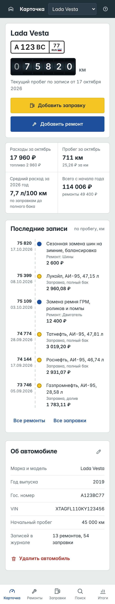
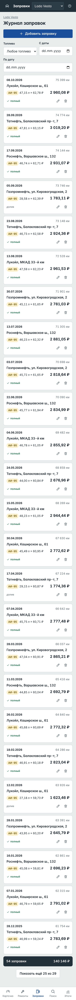
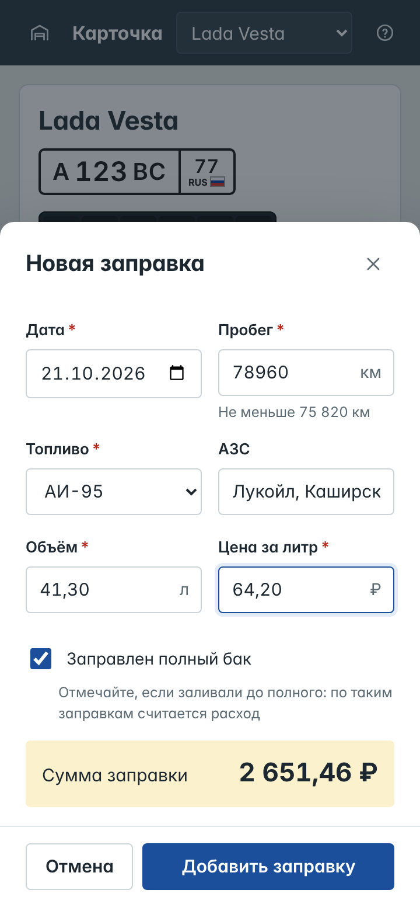
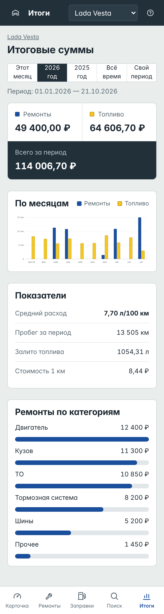

# Бортовой журнал автомобилиста — фронтенд

Учебный проект команды «Старые боги», тема № 1 программы занятий 9–16.
Веб-приложение для учёта ремонтов и заправок автомобиля с привязкой к дате и пробегу, поиском по ремонтам и итоговыми суммами.

Здесь вся часть фронтенд-разработчика:

| Что | Где |
|---|---|
| Рабочий фронтенд — все экраны и функции ТЗ | [`frontend/`](frontend/) |
| Макеты всех экранов, ПК и телефон 360 px (PNG, по ТЗ) | [`mockups/`](mockups/), описание — [`docs/SCREENS.md`](SCREENS.md) |
| Список методов API (MD / DOCX, по ТЗ) | [`docs/API.md`](API.md), [`docs/API.docx`](API.docx) |
| Проверка бэкенда на соответствие списку API | [`tools/check_api.py`](tools/check_api.py) |
| Макет бэкенда для проверки фронтенда без сервера | [`tools/mock_backend.js`](tools/mock_backend.js) |
| Локальная стыковка с бэкендом без CORS | [`tools/dev_server.py`](tools/dev_server.py) |
| Конфигурация nginx для выкладки | [`deploy/nginx.conf`](../deploy/nginx.conf) |


<p>
  
  
  
  
</p>

## Два режима работы

Режим задаётся в одном файле — [`frontend/js/config.js`](../frontend/js/config.js).

| Режим | `USE_MOCK` | Для чего |
|---|---|---|
| Демо | `true` | Показ без сервера: данные хранятся в браузере, демо-вход `ivan.petrov@mail.ru` / `qwerty123` |
| Рабочий | `false` | Все запросы идут на бэкенд по адресу `BASE_URL` |

Сборка не нужна: это чистые HTML, CSS и JavaScript без библиотек.

### Открыть в демо-режиме

```bash
cd frontend
python3 -m http.server 8000
```

Откройте http://localhost:8000. Можно выложить на GitHub Pages: Settings → Pages → ветка `main`, папка `/ (root)`, адрес — `https://<логин>.github.io/<репозиторий>/frontend/`.

## Подключение к бэкенду — по шагам

**1. Бэкендер проверяет свой сервер по контракту.** Скрипту нужен только Python, бэкенд должен быть запущен:

```bash
python3 tools/check_api.py --base http://127.0.0.1:8000/api/v1
```

Скрипт проходит по всем 25 методам так, как их вызывает фронтенд (74 проверки), и выводит список расхождений: не тот код ответа, нет поля, неверная сумма, видны чужие данные. Когда в конце написано «74 из 74», фронтенд с этим сервером заработает. Договорённости, которые проверяются, перечислены в разделе 6 [`docs/API.md`](API.md).

**2. Запускаете фронтенд вместе с бэкендом:**

```bash
python3 tools/dev_server.py --live --backend http://127.0.0.1:8000
```

Откройте http://localhost:5500. Сервер отдаёт фронтенд и пересылает запросы `/api/...` на бэкенд, поэтому CORS настраивать не нужно. Флаг `--live` включает рабочий режим, не трогая `config.js`. Если бэкенд запущен на ноутбуке бэкендера, укажите его адрес в сети: `--backend http://192.168.0.15:8000`.

**3. Выкладка на сервер.** Скопируйте `frontend/` в `/var/www/bja`, в `js/config.js` поставьте `USE_MOCK: false`, подключите [`deploy/nginx.conf`](../deploy/nginx.conf). Это пример: перед запуском поменяйте домен, пути к сертификату и порт бэкенда и проверьте командой `sudo nginx -t`. nginx отдаёт сайт по HTTPS и проксирует `/api/` на бэкенд, сайт и API оказываются на одном адресе.

Если API работает на другом домене, укажите в `config.js` полный адрес (`BASE_URL: 'https://api.example.ru/api/v1'`), а на бэкенде разрешите CORS для адреса сайта.

### Проверить фронтенд без готового бэкенда

[`tools/mock_backend.js`](tools/mock_backend.js) — настоящий HTTP-сервер, который отвечает строго по `docs/API.md` (нужен Node.js 18+):

```bash
node tools/mock_backend.js          # http://localhost:8000 — и сайт, и API /api/v1
```

Фронтенд на этом адресе сразу работает в рабочем режиме, через сеть. Ещё два применения:

- бэкендер смотрит образец ответов: `python3 tools/check_api.py` против макета проходит 74 из 74;
- тестировщик проверяет сервисный режим: `curl -X POST "localhost:8000/__maintenance?on=1"` включает ответы 503, `?on=0` выключает.

## Что умеет фронтенд

Все функции из таблицы 1 ТЗ:

- регистрация, вход, выход;
- добавление, изменение и удаление автомобилей (удаление — с подтверждением и вместе с записями);
- журналы ремонтов и заправок: добавление, изменение, удаление, фильтры, «Показать ещё» для длинных журналов;
- контроль пробега: подсказка допустимого диапазона под полем и ошибка, если пробег противоречит соседним записям (п. 4.3.1);
- расчёт суммы заправки и итога ремонта прямо в форме;
- поиск по ремонтам: текст, категория, период, диапазон пробега, сумма найденного;
- итоги за месяц, год, всё время или свой период: ремонты, топливо, всего, средний расход л/100 км, стоимость 1 км, график по месяцам, ремонты по категориям;
- краткая справка (п. 4.4.13);
- адаптивная вёрстка от 360 px.

Поведение при сбоях, проверенное на макете бэкенда:

| Ситуация | Что видит пользователь |
|---|---|
| Ошибка в поле (422) | Поле подсвечено, под ним текст из ответа сервера |
| Истёк или отозван токен (401) | Переход на вход с сообщением «Сеанс завершён, войдите снова» |
| Технические работы (503) | Жёлтая полоса «Идут технические работы», введённые в форму данные не теряются |
| Сервер не отвечает | Экран «Сервер не отвечает» с кнопкой «Повторить»; вход не сбрасывается |
| Двойное нажатие «Сохранить» | Создаётся одна запись: кнопка блокируется на время запроса |
| Суммы приходят строкой (`"2265.60"`) | Показываются как обычные числа |

## Структура

```
frontend/
  index.html
  css/styles.css
  js/config.js         режим и адрес API — единственное, что меняется при выкладке
  js/api.js            клиент API (методы пронумерованы как в docs/API.md) и встроенный макет сервера
  js/mock-data.js      демо-данные, загружаются только в демо-режиме
  js/ui.js             общие элементы: номерной знак, одометр, окна, поля форм
  js/app.js            экраны и маршруты
docs/
  API.md, API.docx     список методов API
  SCREENS.md           перечень макетов и соответствие функциям ТЗ
mockups/
  desktop/             19 макетов, 1440 px
  mobile/              19 макетов, 360 px
tools/
  check_api.py         проверка бэкенда по docs/API.md
  mock_backend.js      макет бэкенда по сети
  dev_server.py        фронтенд + прокси на бэкенд
  screenshots.py       пересъёмка макетов
  fix_docx.py, reference.docx   оформление API.docx по ТЗ (Times New Roman)
deploy/
  nginx.conf           пример выкладки: HTTPS, прокси API, сервисный режим
```

## Пересъёмка макетов и DOCX

```bash
pip install playwright python-docx && playwright install chromium
python3 tools/screenshots.py
pandoc docs/API.md -o docs/API.docx --reference-doc=tools/reference.docx && python3 tools/fix_docx.py docs/API.docx
```

## Команда

| Роль | Результат |
|---|---|
| Тимлид | Отчёт |
| Аналитик | ТЗ.docx, общее описание БД |
| Бэкенд | Схема БД, сервер и API по `docs/API.md` |
| Фронтенд | Макеты, список API, фронтенд — этот репозиторий |
| Тестировщик | Чек-лист БД.docx |
